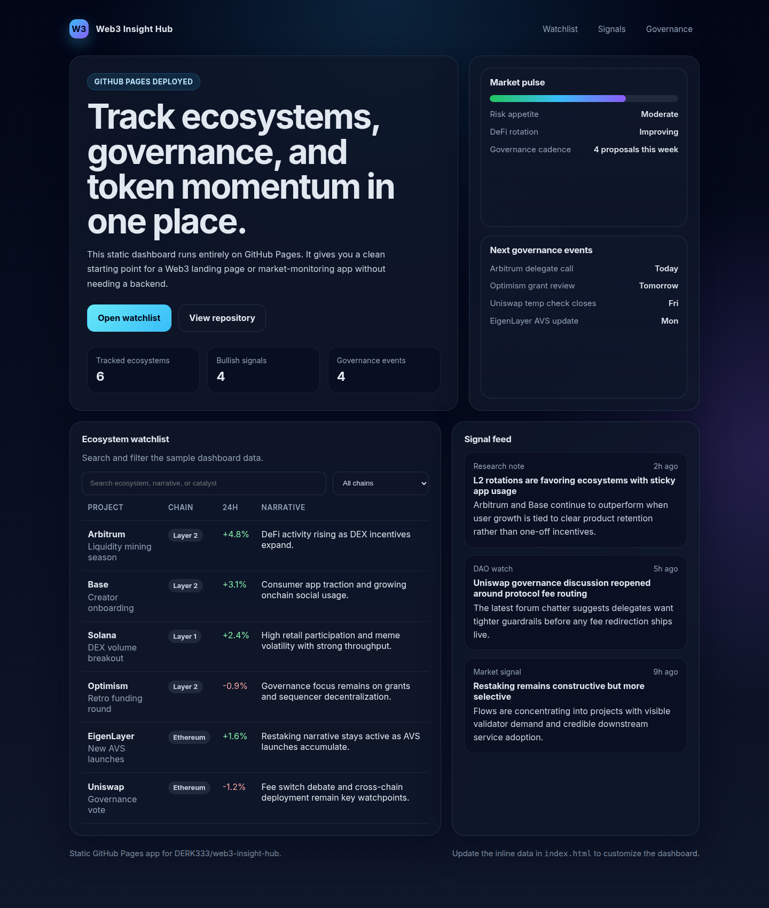

# Web3 Insight Hub

Track ecosystems, governance, and token momentum in one place.

A dark static dashboard that runs on GitHub Pages. The watchlist, the signal feed, and the governance calendar live in a single HTML file. No framework, no server, no API keys.

**[Open the live dashboard](https://derk333.github.io/web3-insight-hub/)** · [Browse the source](https://github.com/DERK333/web3-insight-hub)

[](https://github.com/DERK333/web3-insight-hub/actions/workflows/deploy-pages.yml)



## The board

Four panels, three numbers, and the whole thing fits on one screen.

| Panel | What you get |
| --- | --- |
| Market pulse | Risk appetite, DeFi rotation, and how busy governance is this week |
| Next governance events | Calls, reviews, temp checks, and updates, each with a when |
| Ecosystem watchlist | Searchable rows with chain, 24h move, narrative, and catalyst |
| Signal feed | Short notes tagged research, DAO watch, or market signal |

The counters under the headline are counted when the page loads.

| Counter | Counted from |
| --- | --- |
| Tracked ecosystems | Every entry in `projects` |
| Bullish signals | Entries whose `direction` is `"up"` |
| Governance events | Every entry in `events` |

The sample board ships with **6** ecosystems, **4** bullish rows, and **4** events: Arbitrum, Base, Solana, Optimism, EigenLayer, and Uniswap.

Nav links jump straight to a section: [Watchlist](https://derk333.github.io/web3-insight-hub/#watchlist), [Signals](https://derk333.github.io/web3-insight-hub/#signals), [Governance](https://derk333.github.io/web3-insight-hub/#calendar).

## A briefing you edit

Moves, narratives, and dates are written into the page. Refresh after you edit them and the board updates. The page never calls an exchange, an RPC, or a governance forum.

Search looks through name, chain, narrative, and catalyst. The chain menu fills itself from the `chain` values already on the watchlist. `"up"` paints the 24h move green. `"down"` paints it red. Below 640px the narrative column hides so the table still fits a phone.

The pulse lines — Moderate, Improving, 4 proposals this week — are plain text in the hero. They stay as written until you change that markup. They do not follow the arrays.

## Edit the data

The three arrays sit at the bottom of [`index.html`](index.html).

Watchlist entry:

```js
{
  name: "Arbitrum",
  chain: "Layer 2",
  move: "+4.8%",
  direction: "up",
  narrative: "DeFi activity rising as DEX incentives expand.",
  catalyst: "Liquidity mining season"
}
```

`direction` is `"up"` or `"down"`. `move` is display text, so `"+4.8%"` and `"-0.9%"` are both fine.

Signal:

```js
{
  source: "Research note",
  time: "2h ago",
  title: "L2 rotations are favoring ecosystems with sticky app usage",
  body: "Arbitrum and Base continue to outperform when user growth is tied to clear product retention."
}
```

Governance event:

```js
{ label: "Arbitrum delegate call", when: "Today" }
```

Add a project with a new `chain` and that chain appears in the filter on the next load. The three stat tiles follow the arrays on their own.

## Run it locally

```bash
git clone https://github.com/DERK333/web3-insight-hub.git
cd web3-insight-hub
python3 -m http.server 4173
```

Open [http://localhost:4173](http://localhost:4173).

Opening `index.html` directly works too. The page makes no network requests, so a local server is only there if you want one.

## Deploy

A push to `main` runs [`.github/workflows/deploy-pages.yml`](.github/workflows/deploy-pages.yml). The workflow checks out the repo, uploads the repository root, and publishes it with GitHub Pages.

The live site is [https://derk333.github.io/web3-insight-hub/](https://derk333.github.io/web3-insight-hub/).

`.nojekyll` tells Pages to skip Jekyll and serve the files as they are. `404.html` is a copy of the dashboard, so an unknown path still opens the board. The same workflow can be started by hand from the Actions tab.

## Repository

| Path | What it is |
| --- | --- |
| `index.html` | Layout, styles, sample data, and the renderer |
| `404.html` | The same dashboard for unknown Pages paths |
| `.nojekyll` | Serve the upload as-is |
| `.github/workflows/deploy-pages.yml` | Publish to GitHub Pages on every push to `main` |
| `assets/dashboard.png` | Preview used in this README |

## Support

Support is always good.

- **Liberapay:** [derk333](https://liberapay.com/derk333)
- **Buy Me a Coffee:** [derk333](https://www.buymeacoffee.com/derk333)
- **ETH:** `0xfc8AdbA9D9b12681f463A550f96b53DC0a0Caf46`
- **BTC:** `bc1qf2ma73khgvfl0myucgz7hadn4h09nt8xpnptsh`
- **SOL:** `DYiiCBqRXfrwYqt857YtAbP2rNS31ujr8oALfqp9ZPMg`
- **TRX:** `TJaFuQvnaGefFDM9BMdiviKNumti8vhiym`
